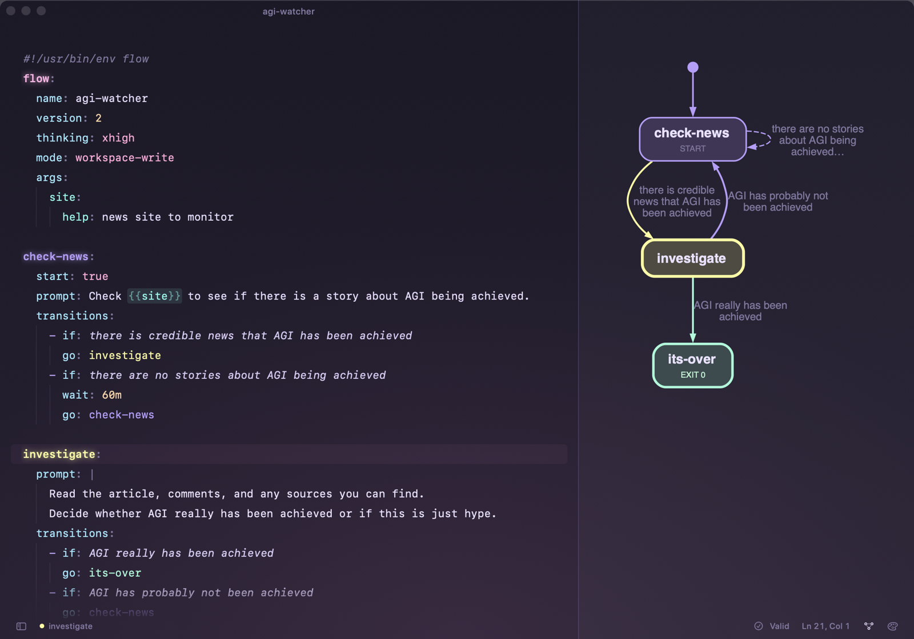

# Eddy

A quiet, native macOS editor for [Flow](https://github.com/yieldthought/flow)
files, with syntax highlighting that understands states and transitions, live
`flow validate`, and a live chart beside the text.



## Install

Needs macOS 15 or later and Xcode 16 (Swift 6). The live chart needs Graphviz
(`brew install graphviz`); validation uses the `flow` command (found on `PATH`
or in `~/Projects/flow/.venv`).

```bash
git clone https://github.com/yieldthought/Eddy.git && cd Eddy
./build.sh --install   # builds build/Eddy.app and copies it to /Applications
open -a Eddy
```

`./build.sh` alone only builds; `--icon` redraws the app icon. The sidebar shows
`~/flows` and `~/Projects/flow` by default; add folders from the `+` menu.

## What it knows about flows

- **States** are coloured with the same hash `flow chart` uses, so a state looks
  the same in the editor, the sidebar outline and the rendered chart.
- `go:` targets take their state's colour; unknown targets get a dotted red underline.
- `` `state-name` `` in a prompt picks up that state's colour too.
- Prompts (`prompt: |`) are read as prose: `{{templates}}`, `` `code` ``, `## headings`,
  `**bold**`, lists and links. Wrapped lines hang under their indentation.
- `flow validate` runs as you type (on a temp copy) and after saving. Problems show
  in the status bar and as marks beside the offending lines.
- Saving keeps the executable bit and writes through symlinks.

## Live graph

The pane on the right draws the flow as you type, without saving. It parses the
buffer and pipes the result to Graphviz `dot` (needs `brew install graphviz`).
It uses `flow chart`'s visual language: a start dot, START / WAIT / EXIT notes,
dashed waits, and each state's colour on its box and on the edges that enter it.

- The state under the cursor glows. With focus mode on, unrelated states dim.
- Click a state to jump to it; click an edge to jump to its `- if:`.
- `go:` targets that don't exist yet appear as dashed red `name?` boxes.
- Condition labels are shown when the graph fits at a readable size and hidden
  otherwise (hover an edge to read it). View → Graph Labels overrides this.
- Drag the divider to resize; pinch to zoom.

## Keys

| | |
|---|---|
| ⌘N / ⌘O / ⌘S / ⌥⌘S | New flow · Open · Save · Save all |
| ⌘B / ⇧⌘B | Validate · Open chart (`flow chart`) |
| ⌥⌘G | Show / hide the live graph |
| ⌥⌘↓ / ⌥⌘↑ | Next / previous state |
| ⌘/ · ⌘] · ⌘[ | Toggle comment · Indent · Outdent |
| ⌥⌘F | Focus: off → current state → current paragraph |
| ⌥⌘T | Typewriter scrolling |
| ⌃⌘T / ⌃⇧⌘T | Next / previous theme |
| ⌘= / ⌘- / ⌘0 | Text size |
| ⌃⌘S | Toggle sidebar (also the button at the bottom left) |

Tab inserts two spaces; Return keeps (and after `key:` or `- `, deepens) indentation.

## Themes

Light: Paper, Solarized Light, GitHub Light, Catppuccin Latte.
Dark: Synthwave Pastel, Ink, Nord, Dracula, Solarized Dark, GitHub Dark, Catppuccin Mocha.

The app follows the system appearance and keeps one light and one dark choice
(defaults: Paper and Synthwave Pastel). Picking a theme of the other kind switches
the app's appearance to match. The palette button sits at the bottom right.

## Layout

```
Sources/Eddy/
  FlowSyntax.swift   line-based YAML + Flow tokenizer (pure, ~1 ms per file)
  FlowGraph.swift    live analysis → Graphviz DOT → SVG
  GraphView.swift    web view pane: in-place updates, highlighting, clicks
  Styles.swift       fonts, line metrics, token → attributes
  Theme.swift        palettes and the shared state-colour hash
  EddyTextView.swift NSTextView: guides, focus dimming, smart indent, pills
  EditorView.swift   SwiftUI bridge, incremental restyling, navigation
  FlowDocument.swift buffers, dirty tracking, save/reload
  AppModel.swift     preferences, sidebar tree, validation
  Views.swift        sidebar, status bar, theme picker, settings
```

`EDDY_SNAPSHOT=<dir> EDDY_THEMES=paper,dracula build/Eddy.app/Contents/MacOS/Eddy`
renders the window to PNGs and exits (also `EDDY_FILE`, `EDDY_STATE`, `EDDY_FOCUS`,
`EDDY_WINDOWED`, and `EDDY_DUMP` for view/layer/titlebar dumps). Your preferences are restored afterwards.
